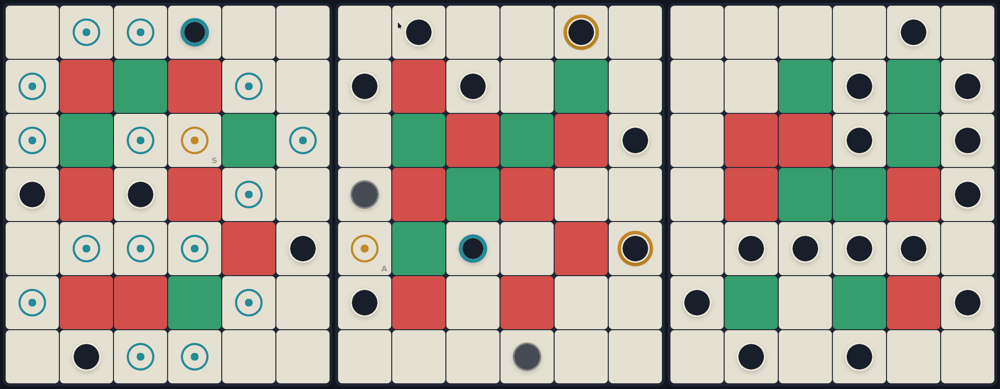

# Hibedi

A full-information grid-based strategy game.



## Play in the browser

Open **[papplappen.github.io/hibedi](https://papplappen.github.io/hibedi/)**: play on one device, or
create a room and send the link to the other player.

## Run the native client

Needs [Rust](https://rustup.rs) (stable).

```sh
cargo run --release -p hibedi-client
```

`--help` lists the options. To play online natively, start the relay
server (`cargo run --release -p hibedi-server`, listens on port 3000)
and have both players run the client with `--server ws://<host>:3000`.

## Run the browser version yourself

Needs Rust with the wasm target, and the `wasm-bindgen` CLI:

```sh
rustup target add wasm32-unknown-unknown
cargo install wasm-bindgen-cli --version 0.2.129 --locked
```

And run the web version with: 

```sh
web/run.sh --open
```

